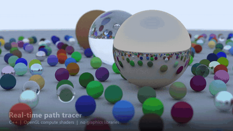
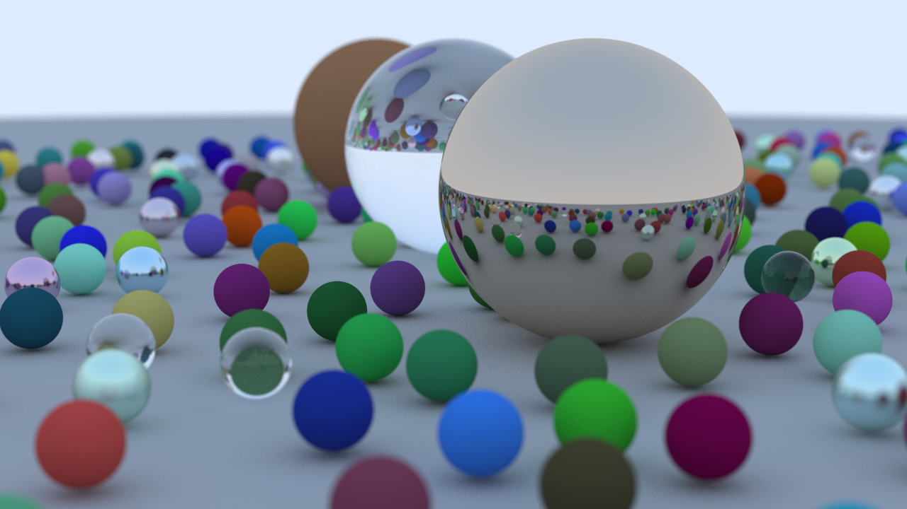
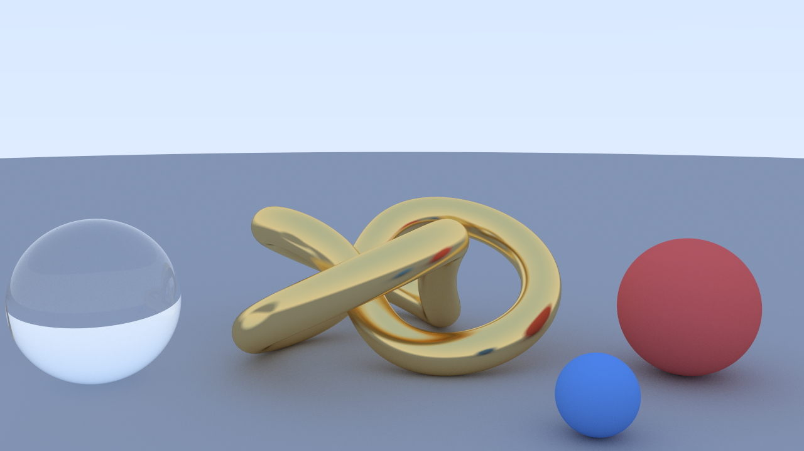
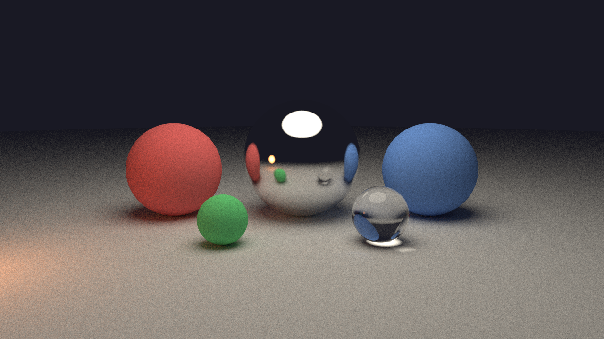

# Raytracer

A real-time path tracer in C++ that runs on **both the CPU and the GPU**. There are no
graphics or rendering libraries: every ray, bounce, and pixel is computed by hand, first
in C++ across all CPU cores, then in an OpenGL compute shader on the graphics card.
You fly the camera around and watch the image sharpen live.

It started from [*Ray Tracing in One Weekend*](https://raytracing.github.io/) and grew into an
interactive renderer, inspired by Sebastian Lague's *Coding Adventure: Ray Tracing*, with
triangle meshes, a BVH, and a GPU port.

[](images/demo.mp4)

*Click for the full 35-second video (1280×720).*



| Mesh (46k triangles) | Glow |
|---|---|
|  |  |

## Performance

These were measured with `raytracer.exe --bench` on a laptop with a Ryzen 9 8945HS (16 threads) and an RTX 4060 Laptop GPU.
The CPU renders at 640×360 and the GPU at 1280×720, so they're compared per sample.
"Msamples/s" means millions of camera rays (each with up to 20 bounces) per second.

| Scene | CPU (16 threads) | GPU (compute shader) | GPU speedup |
|---|---|---|---|
| Book cover (486 spheres) | 1.9 Msamples/s | 127 Msamples/s | **66×** |
| Materials (5 spheres) | 7.2 Msamples/s | 1,421 Msamples/s | **199×** |
| Glow (8 spheres, emissive) | 8.3 Msamples/s | 1,706 Msamples/s | **205×** |
| Mesh (46,080 triangles) | 1.8 Msamples/s | 82 Msamples/s | **47×** |

**BVH speedup (CPU, one frame at 640×360):**

| Scene | Without BVH | With BVH | Speedup |
|---|---|---|---|
| Book cover (486 spheres) | 1,026 ms | 119 ms | **8.6×** |
| Mesh (46,080 triangles) | 171,794 ms | 128 ms | **~1,340×** |

## Features

- **Two renderers, one scene.** Scenes are described as plain data (`scene_desc.h`). The CPU builds
  the book's object classes from it, and the GPU flattens it into arrays and uploads them.
  Press `G` to switch between them live.
- **GPU path tracer.** OpenGL 4.3 compute shader. It uses an iterative bounce loop instead of
  recursion, walks a flattened BVH with a stack, and uses a float-stable sphere test for huge spheres.
  It changes how many samples it takes per frame to hold about 60 fps.
- **Progressive rendering.** Every frame adds new samples to a running average, so noise clears up
  as you watch. Moving the camera starts over.
- **Triangle meshes.** Möller–Trumbore intersection, smooth shading from vertex normals,
  and a Wavefront `.obj` loader.
- **BVH acceleration** on both CPU and GPU.
- **Materials.** Matte (Lambertian), metal with fuzz, glass with refraction and Schlick reflectance,
  and emissive lights.
- **Camera.** Field of view, depth-of-field blur, anti-aliasing, and WASD + arrow-key flying.
- **Multithreaded CPU.** Rows are split across all cores. Random numbers are seeded per pixel and
  per frame, so threads never share state.

## Build & run (Windows, MinGW + CMake)

```bash
cmake -S . -B build -G Ninja
cmake --build build
./build/raytracer.exe
```

Close the window before rebuilding, because Windows won't overwrite a running `.exe`.
The GPU renderer needs OpenGL 4.3. If the GPU can't run it, the program falls back to the CPU.

## Controls

| Key | Action |
|---|---|
| `W` `A` `S` `D` | Move forward / left / back / right |
| `E` / `Q` | Move up / down |
| Arrow keys | Look around |
| `1` `2` `3` `4` | Switch scene (book cover, materials, glow, mesh) |
| `G` | Switch between the CPU and GPU renderers |
| `B` | Turn the BVH on/off (CPU; try it on scene 1, and don't try it on scene 4) |
| `R` | Restart accumulation |
| `P` | Save `image.ppm` |
| `Esc` | Quit |

## Code layout

| File | What it is |
|---|---|
| `src/main.cpp` | Real-time loop: input, CPU/GPU switching, accumulation, benchmark mode |
| `src/scenes.cpp` | The four scenes, as plain data |
| `src/scene_desc.h` | Plain-data scene format shared by both renderers |
| `src/scene.cpp` | CPU renderer: `ray_color` (recursive bounces), camera movement |
| `src/gpu_renderer.cpp` | OpenGL loader, scene upload, flat BVH builder, dispatch, display |
| `src/gpu_shader.h` | The GPU path tracer (GLSL compute shader) |
| `src/camera.h` | Turns a pixel into a ray: field of view, defocus blur, anti-aliasing |
| `src/material.h` | `lambertian`, `metal`, `dielectric`, `diffuse_light` |
| `src/sphere.h` / `triangle.h` | Ray-sphere and ray-triangle intersection |
| `src/obj_loader.h` | Wavefront `.obj` model loader |
| `src/hittable.h` / `hittable_list.h` | Base class for anything a ray can hit, and a list of them |
| `src/bvh.h` / `aabb.h` | Bounding volume hierarchy and bounding boxes |
| `src/vec3.h` / `ray.h` / `interval.h` | Core math types |
| `src/random.h` | Thread-safe PCG random numbers |
| `src/window_win32.cpp` | Win32 window, keyboard, OpenGL context (the only Windows-specific file) |
| `models/torus_knot.obj` | 46k-triangle model, generated by `tools/make_knot.py` |

## Making the demo video

The video is rendered by the program itself along a scripted camera path (`src/demo_reel.cpp`),
then captioned and encoded by a Python script:

```bash
./build/raytracer.exe --reel reel_frames
python tools/make_video.py reel_frames images/demo.mp4 images/demo.gif
```

The script uses ffmpeg if it's on your PATH (or set in the `FFMPEG` environment variable), and falls back to OpenCV otherwise.
The frames take about 2.5 GB, so delete `reel_frames` afterward.

To render your own model, drop any `.obj` into `models/` and change the file name in `scene_mesh()` in `scenes.cpp`.
